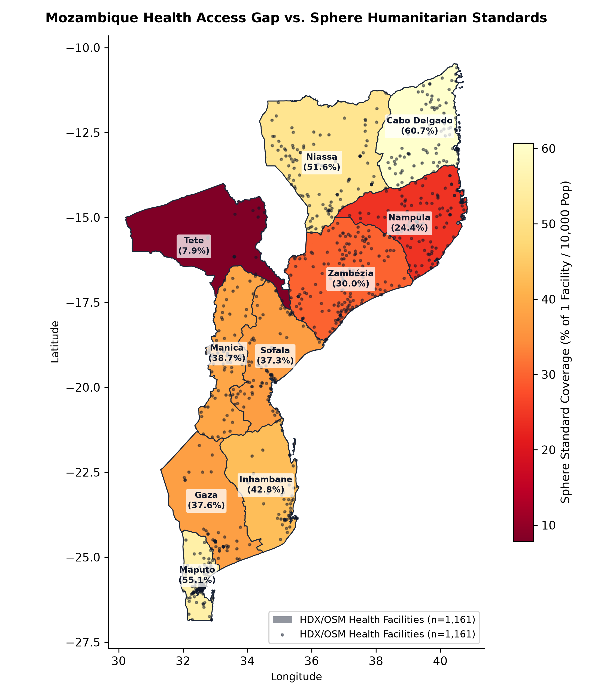
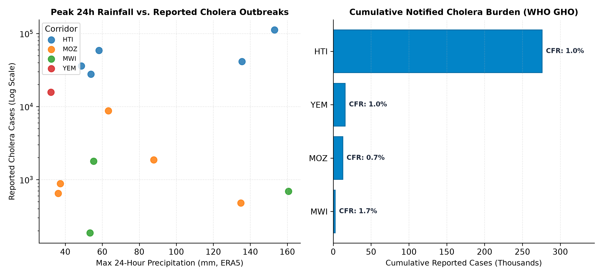
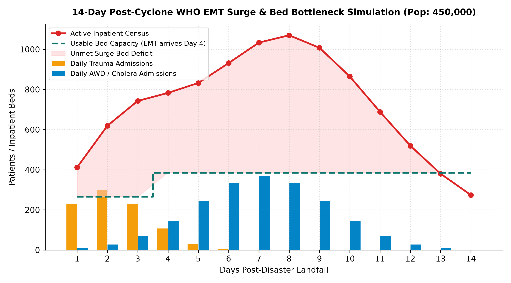

# Disaster Epidemiology, Outbreak Early-Warning & Humanitarian Access

Geospatial humanitarian needs assessment, climate-driven cholera early-warning analysis, and WHO Emergency Medical Team (EMT) surge capacity modeling built on real UN OCHA HDX, WHO Global Health Observatory, and ERA5 reanalysis datasets.

---

## Public Health & Humanitarian Operations Takeaways

1. **Severe Subnational Primary Care Deficits in Cyclone-Exposed Provinces:** Spatial joins of **1,161 georeferenced health facilities** (UN OCHA HDX / Healthsites.io) inside Mozambique ADM1 boundaries against INE population data reveal stark gaps relative to the **Sphere Humanitarian Minimum Standard** (1 primary health unit per 10,000 people). **Tete** reaches only **7.9%** Sphere coverage (126,952 people/facility; 293-facility gap), followed by **Nampula** (24.4% coverage; 503-facility gap) and **Zambézia** (30.0% coverage; 421-facility gap).
2. **Acute Cloudburst Rainfall Drives Post-Disaster Cholera Surges:** Merging WHO GHO cholera surveillance (2000-2024) with Open-Meteo ERA5 daily meteorological reanalysis across five high-risk disaster corridors (MOZ, MWI, YEM, BGD, HTI) via Negative Binomial GLM shows that every **+50 mm increase in peak 24-hour extreme precipitation** is associated with a **1.96x Incidence Rate Ratio** in reported cholera cases.
3. **Hospital Bed Bottlenecks Persist Without Early Waterborne Surge Staging:** Simulating a Category 4 cyclone affecting 450,000 residents (30% baseline bed damage) shows inpatient demand peaking at **1,070 patients on Day 8** against **386 functional beds** (277.2% occupancy; 684 overflow patients) even with a 120-bed WHO EMT arriving on Day 4, demonstrating the operational need to co-deploy dedicated Cholera Treatment Centers (CTCs) alongside trauma teams.

---

## Key Visual Outputs

### 1. Mozambique Humanitarian Health Access Gap vs. Sphere Minimum Standard

### 2. Climate-Driven Cholera Outbreak Risk Across Disaster Corridors (WHO GHO + ERA5)

### 3. 14-Day Post-Cyclone WHO EMT Surge & Inpatient Bed Bottleneck Simulation

---

## Repository Architecture

- data/raw/ - Local cache from WHO GHO OData API, Open-Meteo ERA5 archive, HDX Healthsites GeoJSON, and geoBoundaries ADM1
- data/processed/ - Cleaned climate-cholera panel (cholera_climate_panel.parquet), spatial province access layer (mozambique_province_access.gpkg), and baseline EMT surge trajectory
- outputs/figures/ - High-resolution maps and epidemiological charts (300 DPI)
- scripts/fetch_humanitarian_data.py - Reproducible multi-source API ingestion pipeline
- scripts/generate_figures.py - Automated publication figure generator
- src/outbreak_climate.py - ERA5 precipitation anomaly calculation & Negative Binomial GLM outbreak modeling
- src/spatial_access.py - GeoPandas spatial join, Sphere standard gap calculator, and dynamic 14-day EMT surge simulator
- pp.py - Interactive 3-tab Streamlit dashboard

---

## Reproduction & Local Execution

1. Install dependencies: pip install -r requirements.txt
2. Fetch real WHO, ERA5, HDX, and geoBoundaries datasets: python scripts/fetch_humanitarian_data.py
3. Build processed epidemiological & spatial layers: python src/outbreak_climate.py then python src/spatial_access.py
4. Regenerate maps and charts: python scripts/generate_figures.py
5. Launch interactive Streamlit dashboard: streamlit run app.py
